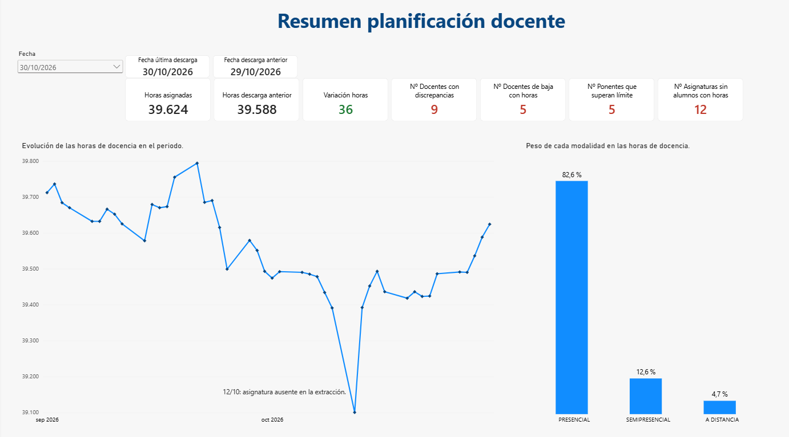
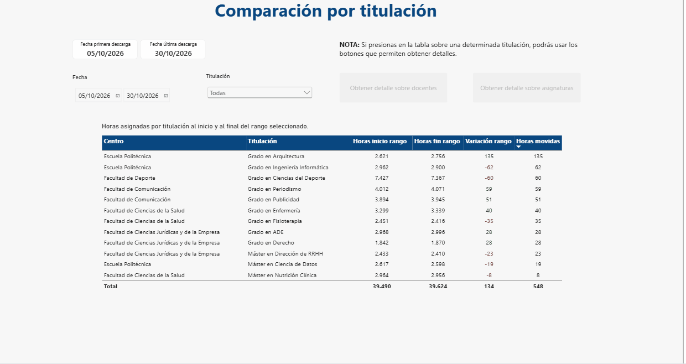

# Control de la planificación docente | Power BI

Informe en Power BI para el seguimiento diario de la planificación docente de una universidad. Compara cada descarga de datos con la anterior, permite analizar cualquier periodo por titulación, asignatura o docente, y detecta automáticamente cinco tipos de errores que, si no se corrigen a tiempo, acaban en pagos incorrectos de nómina.

El proyecto está inspirado en mi experiencia en People Analytics en el sector universitario. **Todos los datos son ficticios** y se generan con un script incluido en el repositorio.



## El problema de negocio

En una universidad, lo que cobra cada docente depende de las horas de docencia que tiene asignadas. Esa planificación no es fija: cambia casi a diario porque se ajustan grupos, se reparten asignaturas o se sustituye a personas que se van. Cada día se descarga una foto completa de la planificación, y el departamento de personal tiene que responder a preguntas como estas:

- ¿Qué ha cambiado desde la última descarga, y a quién afecta?
- ¿Hay horas asignadas a asignaturas que no tienen alumnos?
- ¿Coincide el tipo de contrato de la planificación con el que figura en el maestro de personal?
- ¿Sigue apareciendo con horas alguien que ya se dio de baja?
- ¿Algún colectivo con límite de horas lo ha superado, o está a punto de hacerlo?

Detectar estos errores tarde tiene un coste real: si unas horas se pagan de más y después se corrigen, las condiciones mínimas del convenio pueden impedir recuperar ese dinero.

## Qué hace el informe

| Página | Para qué sirve |
|---|---|
| **Resumen** | Horas actuales frente a la descarga anterior, evolución diaria, peso de cada modalidad y recuento de todos los controles. |
| **Comparación por titulación** | Variación de horas por titulación entre dos fechas, con acceso al detalle por docentes y por asignaturas. |
| **Control de calidad** | Los cuatro controles de datos, con un indicador por control y la tabla de casos detectados. |
| **Ponentes invitados** | Control del límite anual de horas: quién lo supera, desde cuándo y por cuánto, y quién está en riesgo de superarlo. |
| **Ficha del docente** | Consulta individual: horas por asignatura y cambios entre dos fechas. |



### Los cinco controles

| Control | Qué detecta |
|---|---|
| Asignaturas sin alumnos | Horas de docencia asignadas a asignaturas sin alumnos matriculados. |
| Discrepancias de contrato | Docentes cuyo tipo de contrato en la planificación no coincide con el maestro de personal. |
| Bajas con horas | Personas dadas de baja que siguen con horas en la planificación, y cuántos días llevan así. |
| Asignaturas desaparecidas | Asignaturas que faltan en una descarga y vuelven en la siguiente, señal de un fallo en la extracción. Distingue este caso de las bajas legítimas de asignaturas. |
| Límite de ponentes | Ponentes invitados que superan el límite anual de 30 horas, con la fecha en que lo superaron y las horas de exceso, y los que están por encima del 80 % del límite. |

## Datos

Los datos imitan la estructura de un sistema real de planificación, a menor escala:

- **44 extracciones diarias** (días laborables del 1 de septiembre al 30 de octubre de 2026), con 37.967 filas en total y 20 columnas.
- **Maestro de personal** con 227 personas, incluidas altas y bajas.
- **Maestro de asignaturas** con 295 asignaturas de 12 titulaciones y 5 centros.

Los datos vienen sucios a propósito, como en la realidad: filas generadas por error, duplicados y textos escritos de formas distintas. El script `generar_datos.py` los crea con una semilla fija, así que siempre se obtienen los mismos.

## Cómo está construido

### Power Query

- La ruta de los datos está en un **parámetro**, de modo que el informe funciona en cualquier ordenador cambiando un solo valor.
- Combina automáticamente todos los ficheros de la carpeta de extracciones, ignorando archivos que no sean Excel o temporales.
- Limpieza: elimina filas erróneas (sin identificador, con código de error o con cero horas) y duplicados, y normaliza la modalidad. Tras la limpieza quedan 37.367 filas.

### Modelo de datos

Modelo en estrella con una tabla de hechos (la planificación diaria) y tres dimensiones: personal, asignaturas y calendario. Todas las relaciones son de uno a varios y filtran en una sola dirección. La tabla de hechos solo guarda claves y horas; los atributos descriptivos viven en las dimensiones.

### DAX

Algunas decisiones que merece la pena explicar:

- **Medida semiaditiva.** Cada descarga es una foto completa, así que las horas se pueden sumar por docente o por titulación, pero no a lo largo del tiempo. La medida base toma siempre la última descarga del periodo filtrado.
- **Comparación con la descarga anterior, no con el día anterior.** Un lunes se compara con el viernes, no con el domingo, que no tiene datos.
- **Totales correctos.** Cálculos como las horas de exceso o las horas movidas se hacen persona a persona (o titulación a titulación) con `SUMX` y después se suman. Así el total no compensa subidas con bajadas ni trata a todo el colectivo como si fuera una sola persona.
- **Horas movidas frente a variación neta.** En el periodo del 5 al 30 de octubre, la planificación crece solo 134 horas netas, pero se mueven 548 entre titulaciones. Las dos cifras responden a preguntas distintas y el informe muestra ambas.
- **Parámetros de negocio en medidas.** El límite de horas de los ponentes y el umbral de riesgo están en medidas propias, de modo que cambiarlos solo requiere modificar un valor.

### Diseño

- Rojo y verde reservados para bajadas, subidas y alertas; ámbar para los avisos de riesgo.
- Títulos dinámicos en las páginas de detalle, que indican la titulación y las fechas que se están viendo.
- El gráfico de evolución muestra los valores del eje y señala la caída del 12 de octubre, causada por una asignatura ausente en la extracción.

## Cómo abrir el proyecto

1. Descarga o clona el repositorio.
2. Abre `informe/control_planificacion_docente.pbix` con Power BI Desktop (gratuito, para Windows).
3. Ve a **Transformar datos → Editar parámetros** y cambia `RutaDatos` por la ruta de la carpeta `datos/` en tu ordenador, terminada en `\`.
4. Pulsa **Actualizar**.

## Estructura del repositorio

```
├── datos/
│   ├── extracciones_planificacion/   44 ficheros diarios
│   └── maestros/                     maestro_personal.xlsx, asignaturas.xlsx
├── informe/
│   └── control_planificacion_docente.pbix
├── capturas/                         imágenes y GIF de este README
├── generar_datos.py                  script que genera los datos ficticios
└── README.md
```

## Herramientas

Power BI Desktop (Power Query, modelado, DAX) y Python (pandas) para generar los datos.

## Autor

**Juan Poma** · Analista de datos · [LinkedIn](https://www.linkedin.com/in/juanpomas)
